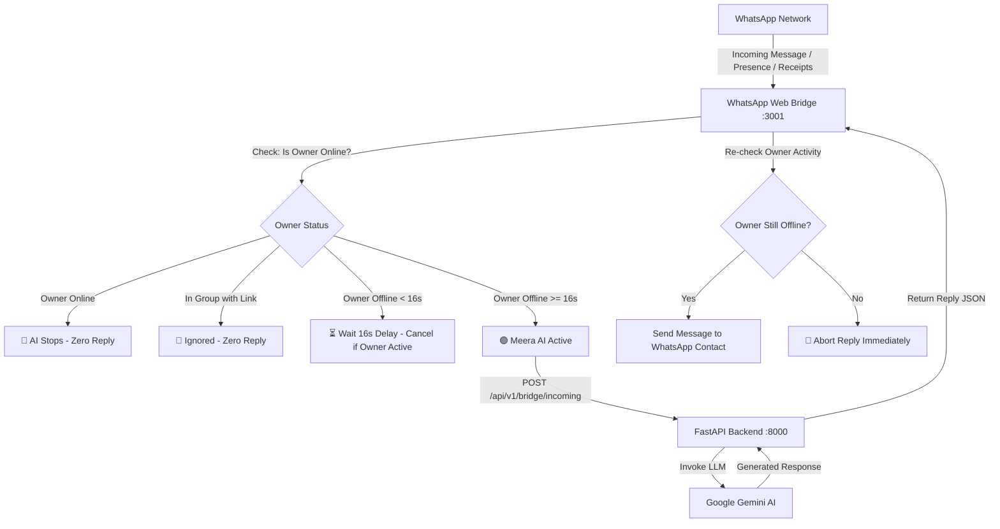

# 🚀 WhatsApp AI (Meera) Auto-Reply & Smart Coexistence System

An intelligent, full-stack automated WhatsApp assistant powered by **Google Gemini AI**, **FastAPI**, and a **Node.js Baileys WhatsApp Web Bridge**.

Meera AI is engineered with real-time owner presence detection, allowing seamless coexistence between you (the owner) and the AI without conflicts or overlapping replies.

---

## 🌟 Core Behavior & Operational Rules

### 1. 👤 Real-Time Owner Detection (Instant Stop & No Replies When Online)
- **Instant AI Stop**: Whenever the owner opens WhatsApp on their phone (read receipts, typing stanzas, active presence, or sending a message), Meera AI **stops immediately**.
- **No Replies While Online**: When the owner is active/online in WhatsApp and users send messages, **Meera AI will NOT reply**. You have full personal control over your chats.
- **Race Condition Protection**: If the owner opens WhatsApp while Gemini is generating a response, the reply is **immediately aborted** before sending.

### 2. ⏳ Exact 16-Second Offline Activation Delay
- **16-Second Timer**: When the owner closes WhatsApp or locks their phone, a **16-second inactivity countdown** begins.
- **Auto-Activation**: Once the owner has been offline/inactive for **16 seconds**, Meera AI automatically comes online and starts replying to user messages.
- **Abort on Re-Open**: If the owner re-opens WhatsApp at any second during the 16-second countdown, the timer is cleared and no AI reply is sent.

### 3. 🚫 Strict Group Link Protection (No Responses & No Replies)
- **Zero Group Link Spam**: When any message containing a link (`http://`, `https://`, `www.`, invite links like `chat.whatsapp.com`, `wa.me`, `t.me`, domain names, or preview cards) arrives in a WhatsApp group:
  - **Meera AI will NOT respond.**
  - **Meera AI will NOT reply.**
- **Group Safety**: Group chats are safeguarded against spam, phishing links, and bot loops.

### 4. 🛡️ Personal Chat Takeover (10 Minutes)
- Whenever the owner sends a manual message to any contact, Meera AI automatically yields and pauses in that specific conversation for **10 minutes**, giving you uninterrupted conversation time.

---

## 🛠️ System Architecture



---

## 🚀 Quick Start Guide

### Prerequisites
- **Python 3.11+** installed
- **Node.js 18+ or 20+** installed
- Free **Google Gemini API Key** from [Google AI Studio](https://aistudio.google.com/)

---

### Step 1: Configure Environment Variables
Inside `backend/.env`:
```env
# Gemini AI Configuration
LLM_PROVIDER=gemini
GEMINI_API_KEY=your_gemini_api_key_here
LLM_MODEL=gemini-1.5-flash

# Database (Uses local SQLite by default)
FALLBACK_TO_SQLITE=True
SQLITE_URL=sqlite+aiosqlite:///data/whatsapp_ai.db

# WhatsApp Bridge Webhook URL
FASTAPI_URL=http://127.0.0.1:8000/api/v1/bridge/incoming
```

---

### Step 2: Start the System

#### Option A: One-Click Startup (Windows)
Double-click:
- [`run_bot.bat`](file:///c:/Users/poola/OneDrive/Desktop/WHATSAP%20AI/run_bot.bat) — Launches both FastAPI backend and WhatsApp bridge.

#### Option B: Manual Startup
**Terminal 1 (Backend)**:
```powershell
cd backend
python -m venv venv
.\venv\Scripts\activate
pip install -r requirements.txt
uvicorn app.main:app --host 0.0.0.0 --port 8000 --reload
```

**Terminal 2 (WhatsApp Bridge)**:
```powershell
cd whatsapp-bridge
npm install
node index.js
```

---

### Step 3: Link Your WhatsApp
1. Open your browser and visit: **[http://localhost:3001/qr](http://localhost:3001/qr)**
2. On your phone: Open **WhatsApp > Settings > Linked Devices > Link a Device**.
3. Scan the QR code shown on the screen.
4. Once connected, Meera AI will activate according to your configured 16-second rule!

---

## 📱 WhatsApp Self-Chat Remote Controls

Send any of these commands to your own WhatsApp number (Self-Chat / "Message Yourself"):

| Command | Action |
| :--- | :--- |
| `!off` or `stop` | **Stops Meera AI manually** (AI will not reply to anyone). |
| `!on` or `start` | **Activates Meera AI** (Resumes 16s offline auto-reply rule). |
| `!status` | **Checks live status** (Shows whether you are detected online or offline). |

---

## ⚙️ Timing Configuration (`whatsapp-bridge/settings.json`)

You can customize the timing rules at any time in [`whatsapp-bridge/settings.json`](file:///c:/Users/poola/OneDrive/Desktop/WHATSAP%20AI/whatsapp-bridge/settings.json):
```json
{
  "isAiPaused": false,
  "pauseUntil": 0,
  "inboundWaitSeconds": 0,
  "ownerInactivitySeconds": 16,
  "chatTakeoverMinutes": 5
}
```

- `ownerInactivitySeconds` (`16`): Exact seconds of inactivity before Meera AI activates after you leave WhatsApp.
- `inboundWaitSeconds` (`0`): Inbound delay before generating reply (0 for instant responses).
- `chatTakeoverMinutes` (`5`): Minutes Meera yields when you manually text a contact.
